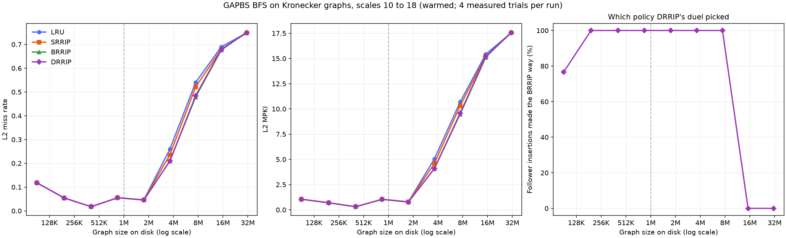

# CPU Cache Replacement Policies in gem5

SRRIP, BRRIP and DRRIP (Static, Bimodal and Dynamic Re-Reference Interval
Prediction) implemented in gem5's C++ memory hierarchy and measured against
LRU at the last-level cache. The question: **no static policy wins
everywhere, so can a policy that chooses at run time get close to the best
one without knowing the workload?**


A pointer chase over a random cycle, swept across a 1 MiB L2. Below capacity
every policy hits. Just past it, they split apart:

- **LRU collapses to a 99 percent miss rate the moment the working set stops
  fitting.** A cyclic pattern is LRU's worst case, because it evicts exactly
  the line needed soonest.
- **BRRIP cuts misses 74 percent against LRU at 1.125 MiB (0.259 against
  0.994).** It inserts most lines as "evict me first", so a stable fraction of
  the working set survives instead of all of it cycling through.
- **The win lives in one narrow band.** It is 60 percent at 1.25 MiB, about 10
  percent at 1.75 MiB, and gone by 2.3 MiB. Past about 3 MiB all four policies
  are within 0.0011 of each other.
- **DRRIP, in purple, tracks BRRIP through the whole transition.** It keeps
  **72 of BRRIP's 74 points** without being told which policy to use.

## Why DRRIP: no static policy wins everywhere

BRRIP's refusal to cache most of what it sees is exactly right when nothing
fits, and exactly wrong when there is a hot set worth keeping. On `mixed.c`, a
512 KiB hot set re-read between 2 MiB streaming scans, **BRRIP is the worst
policy tested: 0.670 against SRRIP's 0.619.** Each hot line it brings back in
is itself the next eviction candidate, so the hot set never rebuilds.

So the right insertion policy depends on the workload, and the hardware has
to commit before the workload is known. DRRIP settles this at run time with
set dueling:
- 32 of the 1024 sets always insert the SRRIP way, and 32 always insert the
  BRRIP way.
- A 10-bit counter tracks which of those two groups is missing more.
- The other 960 sets follow whichever group is currently winning.


**It picks the right policy on its own.** On the chase, follower sets insert
the BRRIP way 95 to 99 percent of the time past capacity. On `mixed.c` they
insert the SRRIP way about 80 percent of the time, and DRRIP lands at 0.625,
next to SRRIP rather than BRRIP. Both figures are read from the policy's own
counters, not inferred from miss rates.

**What DRRIP buys is the smallest worst case.** This is each policy's
largest miss-rate gap to the best policy at the same point, across all 30
workload points:

| Policy | Worst-case loss to the best policy | Where |
|---|---|---|
| LRU | 73.6 points | chase, 1.125 MiB |
| SRRIP | 52.7 points | chase, 1.25 MiB |
| BRRIP | 5.7 points | mixed, 512 KiB hot set |
| **DRRIP** | **2.1 points** | chase, 1.25 MiB |

The warmed dataset gives the same order: DRRIP 2.1, BRRIP 6.9.

That 2.1-point cost is predicted by the design. One set in 32 is an SRRIP
leader, and it keeps thrashing at SRRIP's 0.93 miss rate even after the duel
is decided.

**What DRRIP did not do:**
- **It never clearly beats both static policies.** On a workload whose
  behaviour does not change during the run, the better static policy is a
  ceiling. `phases.c` was built to break that by alternating a thrashing
  phase with a fitting one. BRRIP rebuilt the fitting set fast enough to win
  outright anyway, and DRRIP followed it, about one point behind.
- **On average it ties BRRIP.** Weight all 30 points equally and BRRIP edges
  ahead (0.601 against 0.604). Weight each benchmark equally and DRRIP does
  (0.701 against 0.703). The verdict depends on the workload mix, which is
  exactly the uncertainty DRRIP exists to remove.
- **It cannot tell nearly tied policies apart.** At 2 MiB BRRIP is better by
  1.4 points, but the duel mostly picks SRRIP. A gap that small is not
  enough signal to move the counter consistently, and where the duel cannot
  tell, there is little to lose.

## Does it hold on a real workload? GAPBS BFS

The microbenchmarks each isolate one access pattern. Breadth-first search
from the [GAP Benchmark Suite](https://github.com/sbeamer/gapbs) mixes several
at once:
- random lookups into neighbouring vertices
- a sequential walk of each vertex's edge list
- a parent array and frontier that are reused at every level

It ran serial and static, on Kronecker graphs from scale 10 to 18 (2^10 to
2^18 vertices). Each run loads the graph and does one BFS trial as warmup,
then measures four more trials from different source vertices.



| Graph size on disk | LRU | SRRIP | BRRIP | DRRIP | DRRIP picked |
|---|---|---|---|---|---|
| 1.8 MB or less | all within 0.001 | | | | n/a, few misses |
| 3.7 MB | 0.259 | 0.236 | **0.209** | **0.210** | BRRIP |
| 7.6 MB | 0.540 | 0.521 | **0.479** | **0.484** | BRRIP |
| 15.6 MB | 0.690 | 0.680 | **0.676** | 0.679 | SRRIP |
| 31.8 MB | 0.749 | **0.749** | 0.752 | **0.749** | SRRIP |

What carries over from the microbenchmarks, and what does not:

- **The direction holds, but the size of the win shrinks about fourfold.**
  At its best, BRRIP cuts L2 misses **19 percent against LRU** (3.7 MB
  graph), not the 74 percent it managed on the pointer chase. Real traversal
  has hub vertices that every policy keeps, so there is less thrashing for
  insertion policy to fix.
- **The useful range is wider.** The win spans graphs from about 4 to
  8 times the L2 size, against less than a doubling for the chase. Kronecker
  graphs have a skewed degree distribution, so the hot part of the graph
  keeps fitting long after the whole graph has stopped fitting.
- **The right policy flips again at the largest graph,** where BRRIP becomes
  the worst of the four. **DRRIP follows the flip and stays within 0.5
  points of the best policy at every size.**
- **On BFS alone, BRRIP is just as safe.** Its worst gap is 0.3 points, at
  the largest graph, against DRRIP's 0.5. DRRIP's advantage only appears
  across workloads: BRRIP's worst case anywhere is 5.7 points on `mixed.c`,
  and DRRIP's is 2.1.

**The practical takeaway:** for graph traversal at LLC scale, RRIP-style
insertion is worth about **10 to 20 percent fewer L2 misses than LRU,
smaller than the microbenchmarks suggest.** Either BRRIP or DRRIP captures
it: DRRIP cuts misses 19.1 percent at the 3.7 MB graph, against BRRIP's 19.4.
If the same cache must also serve hot-set workloads, DRRIP is the one that
does not give the win back there. The caveats: this is one kernel on one
graph family, and the size on disk only approximates BFS's real footprint.

## How it works

Every cache line carries a 2-bit **Re-Reference Prediction Value (RRPV)**,
predicting how soon the line will be used again: 0 means soon, 3 means far
away or never. Eviction takes a line at 3, and if there is none, every line in
the set is aged until one appears. A hit sets the RRPV to 0.

**The three policies differ only in where a new line is inserted:**

| Policy | Inserts at | Code |
|---|---|---|
| SRRIP | 2: one chance to prove itself | [`srrip_rp.cc`](src/srrip_rp.cc) |
| BRRIP | 3 (evict first), and 2 only about 3% of the time | [`brrip_custom_rp.cc`](src/brrip_custom_rp.cc), overrides only `reset()` |
| DRRIP | SRRIP's or BRRIP's choice, decided per set by the duel | [`drrip_custom_rp.cc`](src/drrip_custom_rp.cc) |

Two implementation details matter:

- **`reset()` is insertion and `touch()` is a hit.** Swapping them compiles,
  runs, and produces believable wrong numbers.
- **DRRIP's decision is made in `getVictim()`.** Whether a set is a leader
  depends on its index, and gem5 never passes the set to `reset()`. But
  `getVictim()` sees the set and runs exactly once per miss, just before the
  insertion. So it counts the miss, picks the insertion mode, and stores the
  choice on the victim line for `reset()` to carry out. The counter and the
  follower choices are exported as gem5 stats.

## Correctness

- **The policy flag reaches the cache.** LRU and Random give different miss
  counts (3,081,753 against 3,023,520) at identical instruction counts.
  Without this check, a silently ignored flag produces a complete, plausible,
  meaningless dataset.
- **SRRIP and BRRIP are bit-identical to gem5's own RRIP** on chase and
  mixed. I wrote mine from the paper, not from gem5's code. The match only
  holds with gem5's `hit_priority=True`; its default is a different variant
  of the policy.
- **DRRIP is within 1.2 percent of gem5's `DRRIPRP`.** An exact match is not
  expected, because gem5's version keeps separate RRIP state for each
  competing policy where the paper's, and mine, keep one.
- **Two benchmark bugs that produced convincing garbage were caught and
  fixed.** gcc merged repeated read passes at `-O2`, and a sequentially
  scanned hot set made LRU and SRRIP evict identically. Both are written up in
  [`NOTES.md`](NOTES.md).

## Methodology and limits

- **The policy sits at the L2, the last level of a two-level hierarchy.** So
  it sees an L1-filtered, LLC-like access stream. But it is a private 1 MiB
  cache, not a shared multi-megabyte L3.
- **Prefetchers are off at both L1D and L2,** so the measurement reflects
  replacement, not prefetching.
- **`TimingSimpleCPU` in Syscall Emulation mode, single core.** Miss rate
  barely depends on the core. How much a miss *costs* does, and that is not
  measured here.
- **The microbenchmarks isolate one access pattern each:**
  - `chase.c`: thrashing
  - `mixed.c`: a hot set under a streaming scan
  - `phases.c`: a change of phase partway through
  - `stream.c`: no reuse at all, the control, where all four policies read
    1.0000

  They explain *why* each policy wins or loses. They do not rank policies on
  real software.
- **Warmup does not change the conclusions.** Every point was run cold and
  again after a 4M-instruction atomic-core warmup with a stats reset. Below
  capacity, warmup cuts miss rates more than tenfold (0.0036 to 0.0001),
  because those misses were compulsory. But it **moves the SRRIP-minus-BRRIP
  gap by at most 0.0086 anywhere.** Both datasets are committed; the warmed
  plots are the `*_warmup.png` files.
- **Not done:** an out-of-order core, multi-core with thread-aware DRRIP, or
  a sweep of DRRIP's leader count and counter width, which are left at the
  paper's defaults.

## Reproducing

Built against gem5 commit `cbf0eae213`, which produces a single
`build/ALL/gem5.opt` covering every ISA.

```bash
scripts/install_policies.sh ~/gem5 ALL      # copy policies in, register, rebuild
benchmarks/build.sh                         # static microbenchmarks
scripts/sweep.sh ~/srrip-work/m5out 8       # 120 runs; WARMUP_INSTS=4000000 for warmed
scripts/scrape.py ~/srrip-work/m5out -o results/data.csv
scripts/plot.py -i results/data.csv

scripts/gapbs_setup.sh                      # clone GAPBS at a pinned commit, build, make graphs
scripts/bfs_sweep.sh ~/srrip-work/m5out-bfs 12
scripts/scrape.py ~/srrip-work/m5out-bfs -o results/data_bfs.csv
scripts/plot.py --bfs -i results/data_bfs.csv -o plots/bfs.png
```

The policies are registered as `SRRIPRP`, `BRRIPCustomRP` and
`DRRIPCustomRP`, alongside gem5's own `BRRIPRP` and `DRRIPRP`. Everything
else is under:
- [`configs/`](configs/): the harness, with the L2 policy as a parameter
- [`results/`](results/): every data point, committed
- [`plots/`](plots/): every figure
