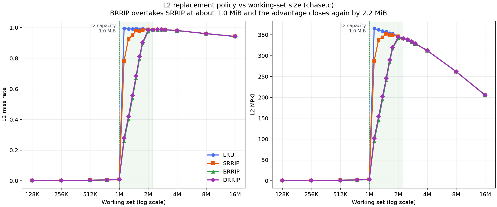
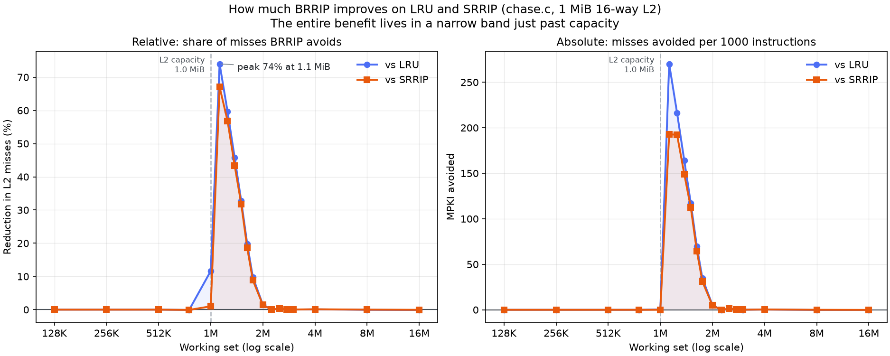
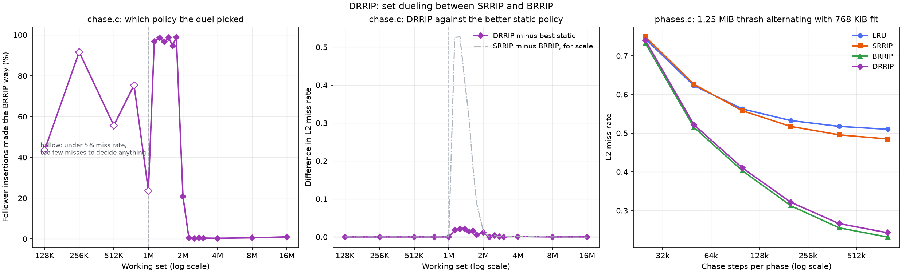
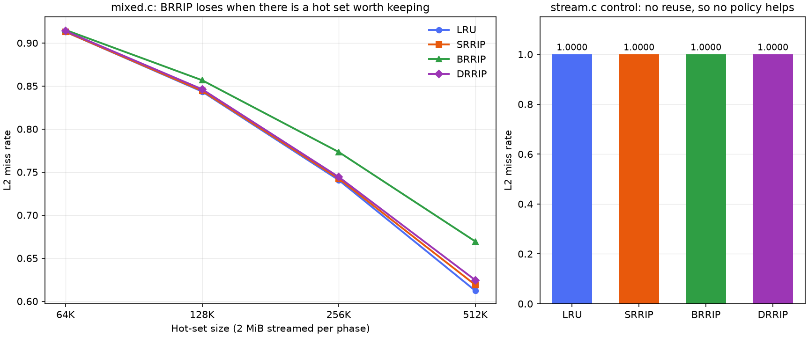

# CPU Cache Replacement Policies in gem5

Three published cache replacement policies, SRRIP, BRRIP and DRRIP (Static,
Bimodal and Dynamic Re-Reference Interval Prediction), implemented in gem5's
C++ memory hierarchy. They are measured across a sweep of working-set sizes
to find where SRRIP and BRRIP cross over, and whether DRRIP's run-time set
dueling picks the right side of that crossover on its own.

## TL;DR

**What was built.** SRRIP, BRRIP and DRRIP as gem5 replacement policies in C++
(`SRRIPRP`, `BRRIPCustomRP` and `DRRIPCustomRP`), a config harness that
exposes the L2 policy as a parameter, and four microbenchmarks. 120 sweep
points, run twice, cold and warmed, for 240 simulations total.

**The headline number.** At a working set 12 percent larger than the 1 MiB
L2, BRRIP misses on 25.9 percent of L2 accesses where SRRIP misses on 78.4
percent and LRU on 99.4 percent. That is a 3.8x reduction in misses against
LRU from changing one line of insertion logic.

**DRRIP picks the right policy without being told.** Past capacity on the
pointer chase, its follower sets insert the BRRIP way 95 to 99 percent of the
time and it misses on 27.7 percent of accesses at that same 1.125 MiB point.
On `mixed.c`, where BRRIP is the wrong choice, they insert the SRRIP way about
80 percent of the time. Across every workload DRRIP stays within 2.1
percentage points of whichever static policy is better at that point. That gap
is the price of dueling, because the sampled leader sets keep running the
losing policy.

**The crossover.** BRRIP overtakes SRRIP right at cache capacity, around
1.0 MiB, and the advantage is gone again by about 2.2 MiB. Past roughly 3 MiB
all four policies sit within 0.0011 of each other, because at several times
capacity there is nothing left for any eviction decision to protect.

**The other side of it.** On `mixed.c`, where a small hot set genuinely is
worth keeping, BRRIP is the *worst* of the three and gets worse as the hot set
grows: 0.6695 against LRU's 0.6122 at a 512 KiB hot set. Neither static policy
wins everywhere, and the boundary sits at a workload property nothing knows
before run time. That is precisely the argument for DRRIP, and DRRIP lands at
0.6245 there, next to SRRIP's 0.6189 rather than BRRIP's 0.6695.

**What DRRIP did not show.** It never clearly beats *both* static policies.
`phases.c` was written to make that happen by alternating a thrashing phase
with a fitting one, but BRRIP turned out to lose almost nothing in the fitting
phase. It won outright at every phase length, and DRRIP followed it. Stated
plainly in [the DRRIP section](#drrip-set-dueling).

**Correctness.** SRRIP and BRRIP miss counts are bit-identical to gem5's own
RRIP implementation on both workloads. DRRIP is within 1.2 percent of gem5's
DRRIP, which is a slightly different algorithm, so exact agreement is not
expected. LRU and Random produce different miss counts at identical instruction
counts, which proves the policy parameter actually reaches the cache rather
than being silently ignored.

**Warmup.** An atomic-core warmup with a stats reset at the switch changes
absolute miss rates by more than tenfold below capacity, but moves the
SRRIP-minus-BRRIP gap by at most 0.0086 anywhere. The cold-cache deltas the
crossover rests on hold up.

**Setup.** Two-level hierarchy with the policy at L2, which is the LLC here.
1 MiB 16-way L2, `TimingSimpleCPU`, Syscall Emulation mode, single core,
statically linked binaries, and prefetchers disabled at both L1D and L2 so the
measurement reflects replacement rather than prefetching.

**Two benchmark bugs were found and fixed**, both of which produced clean,
plausible, meaningless numbers: gcc collapsing repeated read passes at `-O2`,
and a sequentially scanned hot set that made LRU and SRRIP take bit-identical
eviction decisions. Details in [`NOTES.md`](NOTES.md).



The workload is a pointer chase over a randomly permuted list, run against a
1 MiB 16-way L2 with the policy under test installed at that level. Reuse
distance equals the working set, so below capacity every lap hits and all
four policies are indistinguishable. Past capacity a line is evicted before
the chase laps back to it, and the policies separate hard.

The shape is the argument. LRU falls off a cliff the moment the working set
stops fitting, because a cyclic pattern is the worst case for recency: it
evicts precisely the line that will be needed soonest. SRRIP degrades more
gently through the transition, which is its scan resistance working, but it
converges back onto LRU by 2 MiB because scan resistance is not thrash
resistance. Only BRRIP holds a low miss rate past capacity, and only over a
narrow band. **No one static policy is right everywhere, and which one wins
depends on a property of the workload that is not known until run time.**
DRRIP, the purple line, is the run-time answer to that, and it sits just above
BRRIP through the whole transition.

## The size of the win

The plot above shows three absolute curves and leaves you to eyeball the
vertical distance between them. This one plots that distance directly, which
is the quantity the whole project is about.



BRRIP's advantage peaks immediately past capacity and then collapses. At a
1.125 MiB working set it avoids 74 percent of LRU's L2 misses and 67 percent
of SRRIP's, worth 270 MPKI against LRU. One step further out the gain is
already down to 60 percent, by 1.75 MiB it is about 10 percent, and by
2.3 MiB it is gone. Everything BRRIP is good for happens inside roughly one
doubling of the cache size.

The two panels disagree in one place, and the disagreement is the point. At
the capacity point itself the relative panel shows BRRIP taking 12 percent off
LRU's miss count, which sounds worth having until the absolute panel shows it
is 0.4 MPKI. Everything still fits down there, so every policy already hits on
almost every access, and a large share of a very small number is still a very
small number. Quoting only the percentage would make BRRIP look useful in a
region where it does essentially nothing.

That narrowness is the argument for adaptivity rather than against BRRIP. A
policy with a 74 percent win available in one band and nothing outside it is
exactly the case for selecting between policies at run time instead of picking
one at design time. DRRIP keeps 72 of those 74 points at 1.125 MiB.

## DRRIP: set dueling



**How it works.** A few sets in the L2 always insert the SRRIP way and the same
number always insert the BRRIP way. With the defaults that is 32 of each out of
1024 sets, one pair in every 32-set constituency. Leader positions follow the
paper's complement-select pattern, so they move from one constituency to the
next and a strided access pattern cannot land on every leader of one policy. A
10-bit saturating counter, PSEL, goes up on every miss in an SRRIP leader and
down on every miss in a BRRIP leader. The remaining 960 follower sets insert
the BRRIP way when PSEL's top bit is set and the SRRIP way otherwise. Hits,
aging and victim selection are SRRIP's, unchanged, and there is one RRPV per
line.

**Left panel: which policy the duel picked.** This comes from the policy's own
counters, not from inferring it out of miss rates. Through the transition
region, 1.125 to 1.75 MiB, the followers insert the BRRIP way 95 to 99 percent
of the time. Past about 2.3 MiB they settle on SRRIP. The hollow points below
capacity are noise: almost everything hits there, so PSEL barely moves from
where it started.

**Middle panel: what dueling costs.** DRRIP's miss rate minus the better of
SRRIP and BRRIP at each point, drawn against the SRRIP-to-BRRIP gap for scale.
The cost peaks at 2.1 percentage points at 1.25 MiB, against a 53-point gap
between the static policies. Theory predicts almost exactly this: one set in
32 is an SRRIP leader and keeps thrashing at SRRIP's 0.93 miss rate even after
the duel has been decided.

| Working set | LRU | SRRIP | BRRIP | DRRIP | follower inserts the BRRIP way |
|---|---|---|---|---|---|
| 1.125 MiB | 0.9942 | 0.7839 | 0.2585 | **0.2767** | 97% |
| 1.25 MiB | 0.9923 | 0.9268 | 0.3998 | **0.4206** | 98% |
| 1.5 MiB | 0.9942 | 0.9807 | 0.6687 | **0.6825** | 99% |
| 2 MiB | 0.9888 | 0.9879 | 0.9740 | **0.9856** | 21% |
| mixed.c, 512 KiB hot set | 0.6122 | 0.6189 | 0.6695 | **0.6245** | 19% |

**Where the duel is blind.** At 2 MiB BRRIP is better by 1.4 points, yet the
followers mostly insert the SRRIP way. Past 2.3 MiB the two static policies
are within 0.002 of each other. With 32 leader sets each and both groups
missing on nearly every access, a difference that small is not enough signal
to move PSEL consistently in one direction. DRRIP can only choose correctly
when the choice is worth something, which is mostly harmless: where it
cannot tell, there is little to lose.

**Right panel: the negative result.** `phases.c` alternates a 1.25 MiB chase,
which thrashes and favours BRRIP, with a 768 KiB chase that fits. The intent
was a workload where a static policy is wrong for half the run, so DRRIP
could beat both. It did not work out that way. BRRIP rebuilds the small list
quickly enough that it loses almost nothing in the fitting phase, so BRRIP
wins outright at every phase length from 25k to 800k steps. DRRIP correctly
follows it, about one point behind. A phase change alone does not create a
regime where SRRIP wins; the other phase has to contain something BRRIP is
actually bad at. An exploratory run that alternated the thrashing chase with
`mixed.c`'s hot-set-plus-stream phase did show the followers splitting 52/48
between the two policies. DRRIP came in 0.2 points under BRRIP there, which
is a single configuration and too thin a margin to claim. It is recorded in
`NOTES.md` and not in the dataset.

**Reference check.** gem5 ships its own `DRRIPRP`, built on a generic
`DuelingRP` that keeps a separate copy of the RRIP state for each competing
policy. Mine keeps one RRPV per line and varies only insertion, which is
what the paper describes. Configured with the same leader density, the two
agree to within 1.2 percent on chase (1,278,504 against 1,292,969 misses) and
0.6 percent on mixed (463,465 against 460,522). Close agreement is expected;
an exact match is not.

## Scope

Implemented: SRRIP, BRRIP, DRRIP with set dueling, the sweep harness, and the
measurement.

Not done:

- **Out-of-order core.** Every number here comes from `TimingSimpleCPU`. Miss
  rate is a property of the access stream and barely moves on an O3 core. What
  would change is how much a miss *costs*, because an O3 core can overlap
  independent misses. So the speedup from fewer misses would be largest on the
  dependent-load pointer chase and smaller on the streaming workloads.
- **Thread-aware DRRIP.** Single core only. The paper's multi-core variant
  duels per thread.
- **No DRRIP parameter sweep.** Leader density (32 sets per constituency) and
  PSEL width (10 bits) are at the paper's defaults and were not varied.

## What the two supporting workloads add



`chase.c` shows BRRIP winning. `mixed.c` shows it losing, and that matters
more than it looks.

`mixed.c` interleaves a small hot set, re-read four times per phase, with a
2 MiB streaming scan that is never reused. BRRIP is worse than both LRU and
SRRIP here, and the gap widens as the hot set grows: at a 512 KiB hot set,
LRU misses 61.2 percent, SRRIP 61.9 percent and BRRIP 67.0 percent, with
DRRIP at 62.5 percent because it duels its way onto SRRIP. The
reason is the same mechanism that makes BRRIP win on `chase.c`. Inserting
almost everything at the distant re-reference interval means a hot set being
pulled back into the cache cannot accumulate, because each newly inserted hot
line is itself the next eviction candidate. Only the small retained fraction
survives long enough to be hit and promoted.

So the two workloads bracket the problem. BRRIP's refusal to cache most of
what it sees is exactly right when nothing fits and exactly wrong when
something does.

`stream.c` is the control. A sequential scan past capacity has no reuse at any
distance a cache can exploit, so all four policies land on a 1.0000 miss rate,
identical to four decimal places. If they had not, the harness would be
suspect.

## Results

L2 miss rate on `chase.c`, 1 MiB 16-way L2, no prefetchers.

| Working set | LRU | SRRIP | BRRIP | DRRIP |
|---|---|---|---|---|
| 512 KiB | 0.0036 | 0.0036 | 0.0036 | 0.0036 |
| 1 MiB | 0.0093 | 0.0083 | 0.0083 | 0.0083 |
| 1.125 MiB | 0.9942 | 0.7839 | **0.2585** | 0.2767 |
| 1.25 MiB | 0.9923 | 0.9268 | **0.3998** | 0.4206 |
| 1.5 MiB | 0.9942 | 0.9807 | **0.6687** | 0.6825 |
| 1.75 MiB | 0.9928 | 0.9827 | **0.8953** | 0.9005 |
| 2 MiB | 0.9888 | 0.9879 | 0.9740 | 0.9856 |
| 3 MiB | 0.9862 | 0.9863 | 0.9860 | 0.9863 |
| 16 MiB | 0.9419 | 0.9424 | 0.9429 | 0.9424 |

The full dataset, including MPKI and instruction counts for every run, is in
[`results/data.csv`](results/data.csv). It is committed so the plot can be
checked without re-running anything.

Two things worth noting in that table. SRRIP beats LRU substantially in the
transition region, which is its scan resistance doing what it is supposed to
do, but it converges back to LRU by 2 MiB because scan resistance is not
thrash resistance. And past about 3 MiB all four policies are within 0.0011 of
each other, because at four times capacity there is nothing left for any
replacement decision to protect.

## Correctness

Two checks, both of which the implementation had to pass before any of the
numbers above were generated.

**The policy parameter actually reaches the cache.** Running the same binary
under `--policy LRU` and `--policy Random` must produce different L2 miss
counts. It does: 3,081,753 against 3,023,520 at identical instruction counts.
Without this check, a silently ignored policy flag would produce a complete,
plausible, entirely meaningless dataset.

**The policies match a known-good reference.** gem5 ships its own RRIP
implementation. `configs/run.py` exposes it as `--policy SRRIP_REF` and
`--policy BRRIP_REF` purely for comparison, and my implementations produce
**bit-identical miss counts** to it on both workloads. Mine was written from
the paper rather than from that code, which is the point of the exercise, but
agreeing with it exactly is good evidence the result is real. DRRIP has a
looser reference check, described in [the DRRIP section](#drrip-set-dueling),
because gem5's version is a slightly different algorithm.

The comparison only holds with `hit_priority=True` on gem5's side. Its default
is `False`, which is the paper's frequency-priority variant where a hit
decrements the RRPV rather than clearing it. That is a different policy, and
comparing against it initially made a correct implementation look broken.

## Methodology, including the shortcuts

- **Two-level hierarchy.** The policy sits at L2, which is the last level
  here, so L2 is what this writeup calls the LLC. A third level is a
  meaningful amount of config work and would not change the comparison.
- **`TimingSimpleCPU`, not out-of-order.** MPKI is a property of the access
  stream and the cache. An in-order core produces the same stream and
  simulates fast enough to make a 120-point sweep practical.
- **Microbenchmarks, not SPEC.** Four small C programs whose working sets are
  set from `argv`, so the sweep does not require recompiling.
- **Prefetchers off, at both L1D and L2.** gem5's standard library attaches a
  stride prefetcher to each. An L1 prefetcher issues its own requests down to
  L2, so leaving it on means part of the measured L2 access stream was
  generated by the prefetcher rather than the benchmark. This is the
  difference between measuring the replacement policy and measuring the
  prefetcher.
- **Syscall Emulation mode, single core, statically linked binaries.**
- **1 MiB 16-way L2, deliberately small**, so the working set can overrun it
  quickly and each simulation stays short.

## Cache warmup

Absolute miss rates from a cold cache include compulsory misses, that is,
misses on data that was never in the cache to begin with and that no
replacement policy can prevent. Since every policy takes the identical set of
compulsory misses, the deltas between policies stay valid even when the
absolute numbers are inflated. That is the standard argument for why a cold
run still supports a policy comparison.

Rather than rely on that argument, this repo also measures with warmup.
`--warmup-insts N` starts the simulation on an atomic core, which executes
quickly while still moving data through the cache hierarchy, switches to
`TimingSimpleCPU` after N instructions, and calls `m5.stats.reset()` at the
switch so the reported counters describe only the measured window.

The measured window then contains no compulsory misses from the cold start.
Verified: at a 4,000,000-instruction warmup, `simInsts` in the measured window
is exactly the full-run count minus the warmup, and gem5 logs the CPU switch.

The full warmed dataset is in
[`results/data_warmup.csv`](results/data_warmup.csv), plotted in
[`plots/crossover_warmup.png`](plots/crossover_warmup.png). Comparing the two:

| Working set | LRU cold | LRU warm | SRRIP cold | SRRIP warm | BRRIP cold | BRRIP warm |
|---|---|---|---|---|---|---|
| 512 KiB | 0.0036 | 0.0001 | 0.0036 | 0.0001 | 0.0036 | 0.0001 |
| 1 MiB | 0.0093 | 0.0002 | 0.0083 | 0.0002 | 0.0083 | 0.0002 |
| 1.125 MiB | 0.9942 | 1.0000 | 0.7839 | 0.7845 | 0.2585 | 0.2550 |
| 1.25 MiB | 0.9923 | 1.0000 | 0.9268 | 0.9312 | 0.3998 | 0.3955 |
| 1.5 MiB | 0.9942 | 1.0000 | 0.9807 | 0.9865 | 0.6687 | 0.6713 |
| 2 MiB | 0.9888 | 1.0000 | 0.9879 | 0.9992 | 0.9740 | 0.9845 |

Warmup changes the absolute numbers substantially and in exactly the places
theory says it should. Below capacity the miss rate falls by more than an
order of magnitude, from 0.0036 to 0.0001, because essentially every cold-run
miss down there *was* a compulsory miss. Past capacity, LRU rises to a flat
1.0000: with a cold cache it picked up a handful of hits while the cache was
still filling, and with a warm one it misses on genuinely every access, which
is the correct behaviour for a cyclic reference pattern larger than the cache.

The gap between the two policies under test, which is what the crossover
actually consists of, barely moves:

| Working set | SRRIP minus BRRIP, cold | warm |
|---|---|---|
| 1.125 MiB | 0.5255 | 0.5295 |
| 1.25 MiB | 0.5271 | 0.5356 |
| 1.5 MiB | 0.3120 | 0.3152 |
| 1.75 MiB | 0.0873 | 0.0863 |
| 2 MiB | 0.0139 | 0.0148 |

So the cold-cache argument holds up: the absolute miss rates were inflated,
the deltas were not, and the conclusion is the same either way. The warmed
numbers are the ones to quote, and both datasets are committed.

DRRIP holds up the same way. Warmed, it reads 0.2711 at 1.125 MiB and 0.4170
at 1.25 MiB, against 0.2767 and 0.4206 cold, and its gap to BRRIP is never
more than 2.1 points. The warmed version of the DRRIP figure is
[`plots/drrip_warmup.png`](plots/drrip_warmup.png). The duel's choices are
cleaner there. Through the transition the followers insert the BRRIP way 100
percent of the time, and past 2.3 MiB they sit at exactly 0 percent. The
blind spot described above shows up more starkly.

One caveat on the warmed data. At the largest working sets the benchmark
spends a growing share of its instructions building the permuted list, so a
fixed 4,000,000-instruction warmup no longer clears the whole setup phase. The
16 MiB point reads 0.9716 rather than 1.0000 for that reason. It does not
affect the transition region, which is where every conclusion here comes from.

## Repository layout

```
.
├── README.md
├── NOTES.md                    working notes: field names, dead ends, decisions
├── src/
│   ├── srrip_rp.hh/.cc         SRRIP
│   ├── brrip_custom_rp.hh/.cc  BRRIP, inherits SRRIP and overrides reset()
│   ├── drrip_custom_rp.hh/.cc  DRRIP, set dueling between the two
│   └── ReplacementPolicies.py.snippet   SimObject registration
├── configs/
│   ├── run.py                  one simulation: policy, geometry, benchmark
│   └── hierarchy.py            modified stdlib hierarchy exposing the L2 policy
├── benchmarks/
│   ├── build.sh
│   ├── chase.c                 randomly permuted pointer chase, the workhorse
│   ├── stream.c                sequential scan, the control
│   ├── mixed.c                 hot set plus streaming scan
│   └── phases.c                thrashing and fitting chases, alternating
├── scripts/
│   ├── install_policies.sh     copy into a gem5 tree, register, rebuild
│   ├── sweep.sh                run the full sweep in parallel
│   ├── scrape.py               stats.txt and config.json to CSV
│   └── plot.py                 the figures
├── results/
│   ├── data.csv                cold-cache dataset, 120 runs
│   └── data_warmup.csv         same sweep with warmup, 120 runs
└── plots/
    ├── crossover.png           miss rate and MPKI vs working set
    ├── brrip_improvement.png   how much BRRIP wins by, and where
    ├── drrip.png               what the duel picked, what it cost, phases.c
    ├── workloads.png           mixed.c hot-set sweep and stream.c control
    └── *_warmup.png            the same figures from the warmed dataset
```

## Reproducing

Needs a gem5 checkout. Built and measured against gem5 at commit `cbf0eae213`,
which produces a single `build/ALL/gem5.opt` covering every ISA rather than
the older per-ISA `build/X86/gem5.opt`.

```bash
# 1. Compile the policies into gem5 and rebuild. Idempotent.
scripts/install_policies.sh ~/gem5 ALL

# 2. Build the microbenchmarks.
benchmarks/build.sh

# 3. Run the sweep. Writes one gem5 output directory per point.
scripts/sweep.sh ~/srrip-work/m5out 8

# 4. Scrape and plot.
scripts/scrape.py ~/srrip-work/m5out -o results/data.csv
scripts/plot.py -i results/data.csv -o plots/crossover.png
```

`install_policies.sh` copies the six policy sources into
`src/mem/cache/replacement_policies/`, appends the SimObject declarations to
`ReplacementPolicies.py`, adds the sources to the `SConscript`, and rebuilds.
Re-running it does not duplicate the registrations.

Note that the policies are named `SRRIPRP`, `BRRIPCustomRP` and
`DRRIPCustomRP`. gem5 already ships a `BRRIPRP` and a `DRRIPRP`, so the custom
names keep both versions in the same binary and leave upstream untouched.

For the warmed dataset, set `WARMUP_INSTS=4000000` on the sweep and write to a
separate output directory.

## Implementation

The interesting part is small, which is the nature of the idea.

Every cache line carries a Re-Reference Prediction Value, a two-bit counter
predicting how soon that line will be used again. Zero means very soon, the
maximum means far away or never. Eviction takes a line at the maximum; if
there is none, every candidate is aged until one exists.

`touch()` fires on a hit and sets the RRPV to zero. `reset()` fires on
insertion. **SRRIP and BRRIP differ only in what `reset()` writes.** SRRIP
inserts at maximum minus one, meaning "probably not soon, but here is one
chance". BRRIP inserts at the maximum for the large majority of lines, meaning
"evict me first", and at maximum minus one only with probability `btp`,
defaulting to about 3 percent.

`BRRIPCustom` therefore inherits from `SRRIP` and overrides exactly one
method. Expressing it as inheritance rather than a copied file states the
actual claim: the only difference between these two policies is where lines
enter the cache.

The one detail worth stating loudly, because getting it wrong compiles, runs,
and produces plausible wrong numbers: **`reset()` is insertion and `touch()`
is a hit.** Reversing them yields a policy that behaves like a bad LRU variant
and reports believable numbers that mean nothing.

`getVictim()` uses one small optimisation over the textbook formulation.
Instead of scanning for the maximum RRPV, aging everything, and rescanning, it
finds the largest RRPV present in a single pass and ages every candidate by
exactly the difference. The victim and the resulting counter values are
identical, because aging applies the same increment to every candidate.

`DRRIPCustom` inherits from `BRRIPCustom`, so it has both insertion behaviours
available, and adds only the choice between them. One interface problem had
to be solved. Whether a line is in a leader set depends on its set index, and
gem5 does not pass the set to `reset()`. But `getVictim()` sees the
candidates, every candidate knows its set, and gem5 calls `getVictim()`
exactly once per miss, just before inserting into the way it returns. So the
duel runs entirely inside `getVictim()`:
1. Count the miss against the set's leader group, if it has one.
2. Choose the insertion mode.
3. Leave the choice in the victim's replacement data.

`reset()` then reads that flag and calls SRRIP's or BRRIP's insertion
unchanged. The cache invalidates the victim between those two calls, so
`invalidate()` must leave the flag alone, and it does. PSEL and the follower
counts are exported as gem5 stats, so the duel's decisions can be read
straight out of `stats.txt`.
